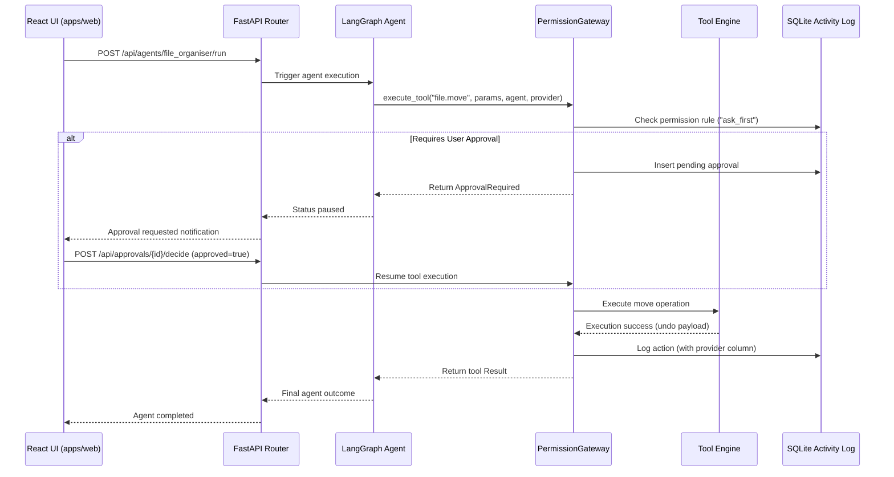

# Miko Architecture

> Owner: Shared (P1 / P2 / P3 / P4)  
> Purpose: Architectural overview of Miko subsystems, boundary abstractions, and execution lifecycle  
> TODO: Add detailed sequence diagrams for LangGraph state transitions and RAG retrieval pipelines

```
+-------------------------------------------------------------+
|                      User Layer                             |
|    Desktop (Tauri)  /  Web Browser (React + TS + Vite)      |
+------------------------------+------------------------------+
                               | REST / SSE (127.0.0.1:8000)
+------------------------------v------------------------------+
|                     FastAPI API Layer                       |
|   /api/activity  /api/approvals  /api/permissions  /api/seed |
+------------------------------+------------------------------+
                               |
+------------------------------v------------------------------+
|                    Agent & Graph Layer                      |
|       LangGraph Orchestration (Router, Inbox, Docs,         |
|             File Organiser, Daily Briefing)                 |
+--------------+------------------------------+---------------+
               |                              |
+--------------v---------------+ +------------v---------------+
|     Permission Gateway       | |       ModelProvider         |
|  (Gatekeeper for Tool Calls) | |  (Ollama / Nebius / Mock)   |
+--------------+---------------+ +------------+---------------+
               |                              |
+--------------v---------------+ +------------v---------------+
|        Local Tools           | |  Models (Local / Cloud)    |
| (Files, IMAP, CalDAV, SQLite)| |  (Ollama 127.0.0.1 /       |
|                              | |   Nebius Token Factory)    |
+------------------------------+ +----------------------------+
```

---

## 1. Architectural Layers

1. **Presentation Layer (`apps/web`, `apps/desktop`):**
   - Built with React, TypeScript, and Vite.
   - Wrapped inside a lightweight native desktop shell using Tauri for cross-platform system tray integration.
   - Communicates strictly over local HTTP/JSON (`127.0.0.1:8000`) with zero external telemetry.
   - Displays real-time privacy notifications (e.g., "Prompts leave this machine" banner when Nebius mode is active).

2. **API & Interface Layer (`backend/app/api`):**
   - FastAPI routers serving strictly typed Pydantic schemas.
   - Decoupled into modular routers: activity logs, pending approvals, permissions management, system settings, synthetic data seeding, and agent execution.

3. **Autonomous Agent Layer (`backend/app/agents`, `backend/app/graphs`):**
   - Stateful agent execution orchestrated via LangGraph.
   - Human-in-the-loop approval pause nodes integrated directly into workflow graphs.
   - Rule-first routing: deterministic heuristics handle known patterns; LLM invoked only when intent is ambiguous.

4. **Safety & Policy Gateway (`backend/app/gateway`):**
   - Single point of entry for all side-effecting operations.
   - Validates requested tool actions against `config/permissions.default.yaml`.
   - Intercepts sensitive operations (`ask_first`) and returns `ApprovalRequired`.
   - Audits all executed and pending actions into SQLite `activity_log` with provider provenance.

5. **Model Abstraction Layer (`backend/app/providers`):**
   - Abstract `ModelProvider` class shielding agents from vendor-specific details.
   - Implementations: `OllamaProvider` (strictly binds to `127.0.0.1`), `NebiusProvider` (OpenAI-compatible client pointing to Token Factory), and `MockProvider` (deterministic canned payloads).

6. **Data & Storage Layer (`backend/app/core/db.py`, `backend/app/rag`):**
   - SQLite embedded storage for tasks, activity log, permissions, and app settings.
   - Semantic document search powered by `sqlite-vec` embeddings.

---

## 2. ModelProvider Interface

The model provider contract guarantees that agent code never couples to concrete network clients or model endpoints:

```python
class ModelProvider(ABC):
    @property
    @abstractmethod
    def name(self) -> str:
        """Returns provider identifier: 'local' | 'nebius' | 'mock'."""
        pass

    @abstractmethod
    async def chat(
        self,
        messages: list[dict[str, str]],
        tools: list[dict[str, Any]] | None = None
    ) -> ChatResult:
        """Sends conversation history and optional tool specs, returning structured result."""
        pass

    @abstractmethod
    async def embed(self, texts: list[str]) -> list[list[float]]:
        """Computes dense vector representations for retrieval."""
        pass
```

All model configurations (tags, memory footprints, context windows) are centralized in `config/models.registry.yaml`.

---

## 3. Permission Gateway

Every tool invocation MUST pass through `execute_tool(action_type, params, agent, provider)`. Direct tool execution from agent nodes is prohibited by architecture.

- **Action Rules:**
  - `act_alone`: Executes immediately, logs to activity log, returns result.
  - `ask_first`: Generates a pending approval record, pauses workflow, returns `ApprovalRequired`.
  - `never`: Rejects execution immediately with a permission denied error.
- **Undo Engine:** Every mutating tool (e.g., file move, rename) records reverse actions in the activity log enabling one-click undo.

---

## 4. End-to-End Data Flow


